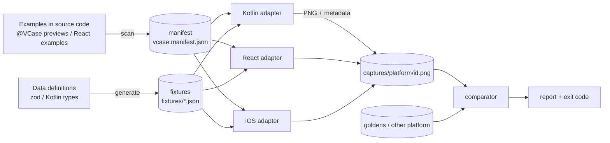

# vcase design

The design of a general visual-testing framework. vcase ("visual case") is the working name.
This is a port of design draft v1 (2026-11-20, task #proj-mobile:#209), followed by the
decisions taken on its open questions. The earlier survey of the current setup and of the
industry is "Visual testing architecture assessment".

Phase 1 implementation status is marked with **[built]**, **[partial]** or **[planned]**.

## Decisions

These were open questions in the draft. They are now decided:

1. **The cross-platform baseline is the web.** The app is compared against the web page with
   the same id, and differences are either fixed in the app or declared as divergences.
2. **vcase lives in its own repository from day one** (`botiverse/vcase`). It does not start
   inside the mobile repository. Raft mobile is its first consumer.
3. **Same-platform regression is zero tolerance and gates merges from day one.**
   **Cross-platform comparison is report-only at first.** A case is switched to gating
   once it has proved stable. The draft suggested fewer than 2 false alarms a week as the bar.
4. **Goldens are stored per renderer**: `goldens/desktop-skiko/`, `goldens/android-robolectric/`, ...
   Switching a renderer (or its fonts) re-records only that renderer's set.

## Goals and limits

- **A case is written in one place.** Cases are declared in source code (Kotlin previews,
  React examples). The manifest is produced by scanning, not written as JSON by hand.
- **Fake data is not hand-made.** It is generated from shared data definitions with a fixed
  seed. Edge cases are presets, not something every test rewrites.
- **Any Kotlin Compose or React project can adopt it.** It does not depend on Raft
  business code. Raft is the first user.
- **Same platform: zero tolerance. Across platforms: differences are declared explicitly.**
  Tests no longer pass by tuning a percentage.
- **Out of scope**: end-to-end flows (taps, navigation, real backend) stay with e2e. No AI
  image judging. No self-hosted image site: reports are a static page, or are sent to Argos.

## Core concepts



| concept | what it is | who provides it |
|---|---|---|
| case | A UI state that can be rendered on its own: a variant of a component, or one state of a page. Has a globally unique id. | Developers annotate it in source code. |
| axis | A dimension the same case is expanded over: theme, viewport, locale, input method (finger / mouse), font scale. | Project defaults, plus overrides per case. |
| fixture | The data a case needs to render, generated from types or recorded. | Referenced by the generator's name. |
| adapter | One platform's "give me an id and data, get back an image". | vcase, one per platform. |
| pairing | Which two images are compared: same platform new vs old (regression), or the same id across platforms (parity). | The `parity` field in the manifest. |
| divergence | An allowed, decided difference of one case between two platforms, with its origin and an expiry condition. | Written into the source code at review. |

## Case manifest **[built]**

The manifest is the output of a scan. It is committed only so that reviews show which cases
were added or removed. CI scans again and fails if the result differs from the committed
file. Format:

```jsonc
{
  "schema": "vcase/1",
  "project": "raft-mobile",
  "defaults": {
    "theme": ["light", "dark"],
    "viewport": [{ "name": "phone", "w": 390, "h": 844, "density": 3 }],
    "locale": ["zh-CN"],
    "pointer": ["touch"]
  },
  "cases": [
    {
      "id": "ds.button.variants",
      "kind": "component",            // component | screen
      "source": "compose/designsystem/.../RaftButtonCases.kt:12",
      "fixture": null,
      "axes": { "pointer": ["touch", "fine"] },
      "parity": ["web:ui.button.variants"],
      "divergences": []
    },
    {
      "id": "screen.channel.members",
      "kind": "screen",
      "source": "compose/shared/.../ChannelMembersCases.kt:20",
      "fixture": "members.channel(count=24, preset=long-names)",
      "axes": { "theme": ["light", "dark"], "viewport": ["phone", "wide"] },
      "parity": ["web:screens.channel.members"],
      "divergences": [
        { "with": "web", "region": "header", "kind": "platform-difference",
          "why": "The app header uses the system back gesture, no back button",
          "decidedBy": "artin", "ref": "#proj-mobile:xxxx" }
      ]
    }
  ]
}
```

Phase 1 additions to `vcase/1` (all optional, omitted from the JSON while unset):

- `defaults.fontScale`: a list of font scales. The default is `[1.0]`.
- `viewport[].optIn`: the viewport is declared, but it is used only by cases that name it.
- `cases[].formerly`: previous ids.
- `cases[].needsDevice`: the case can only be rendered on a device or emulator.
- `divergences[].expires`: an ISO date.
- `viewport[].sizeClass`: the layout mode the host pins for the viewport (`compact`, `wide`).
  It is not an axis and is not part of file names.
- `cases[].capture`: per-case capture settings, each optional: `maxWidth` / `maxHeight`
  (dp bounds of a component capture), `settleFrames` (frames before the captured one) and
  `frameIntervalMs` (frame `i` at `i * frameIntervalMs` ms; 0 = every frame at time 0).

### Id rules **[built]**

The shape is `layer.domain.name`: lowercase, separated by dots.

- `ds.*`: design-system components
- `screen.*`: pages
- `part.*`: parts of a page

The same UI on the app and on the web has the same id, because cross-platform pairing relies
on it. So ids never name a platform. When a case is renamed, write `formerly` in the source
code and move the goldens with it. Deleting one case and adding another would lose its history.

### Axis expansion **[built]**

The number of captures for a case is the cartesian product of its axis values. Image file
names are made from the id and the axis values: `screen.channel.members@dark,wide.png`.
Defaults are written only in `defaults`, and a case lists only the axes that differ. Tests
no longer hand-write a light/dark loop each time.

Phase 1 naming rule: theme and viewport are always in the name. Locale, pointer and font scale
(`fs1.3`) are in the name only when the case overrides that axis, or when the default has
more than one value for it.

## Adapters

### Kotlin Compose **[built: desktop; planned: Android/Robolectric]**

The developer writes an annotated plain function, not a test class:

```kotlin
@VCase("screen.channel.members", fixture = "members.channel(count=24, preset=long-names)",
       parity = ["web:screens.channel.members"])
@Composable
fun ChannelMembersCase(data: MembersFixture) {
    ThreadMembersPageContent(members = data.members, onOpen = {}, ...)
}
```

- The draft had `@VCase` also act as a `@Preview` (a meta-annotation), so the case shows in
  Android Studio. **[planned]** Phase 1 keeps `vcase-annotations` dependency-free, so
  `@Preview` is added next to `@VCase` where it is wanted.
- Scanning uses ComposablePreviewScanner (Roborazzi already ships it) and runs on the JVM /
  Desktop target, so cases in KMP `commonMain` are found too. Android-only cases keep using
  Robolectric. **[built]** `JvmAnnotationScanner` (ComposablePreviewScanner 0.9.3) scans
  the custom annotation directly. The annotation values are read by reflection, and
  ClassGraph adds `file:line`.
- At render time the adapter handles theme, viewport, locale, input method, a fixed clock,
  stopped animations (Raft keeps its `LocalRaftSpinnerStillStep` and
  `ScreenshotTimeContext`) and pinned fonts. The project injects its own theme and these
  freeze settings through a `VCaseHost` interface. The framework does not know about Raft.
  **[built]** Frames render at fixed times (`frameTimeNanos`), and density and font
  scale come from the axes. A case can override the frame plan (`settleFrames`,
  `frameIntervalMs`) and the content-size bounds (`maxWidth`, `maxHeight`); the host maps
  the viewport's `sizeClass` and the pointer axis to the theme's layout and input modes.
- The data parameter's type follows from the fixture name. The adapter deserializes the
  generated JSON into it (kotlinx.serialization). **[planned]** In phase 1 cases have no
  parameters. A case with a parameter is reported as an error. The fixture name is
  available through `LocalVCaseVariant`.

### React **[planned]**

```tsx
// button.cases.tsx
export const meta = vcase({ id: "ui.button.variants", parity: ["mobile:ds.button.variants"] });
export default function Variants() { return <ButtonGallery />; }

// a page case
export const meta = vcase({ id: "screens.channel.members",
  fixture: "members.channel(count=24, preset=long-names)" });
export default function Members({ data }: CaseProps<MembersFixture>) {
  return <ChannelMembersPage members={data.members} />;
}
```

- The format is compatible with Storybook CSF (default export + named `meta`). Projects
  that already have stories can scan them without rewriting.
- The raft-design docs site's 405 examples (`*.composition.tsx`) become cases with one
  added `meta` line. Rendering reuses the existing `/iframe/example` URL.
- The adapter is a Playwright script. It starts a Vite host page that renders only the case,
  opens it by id, waits for fonts and images, and captures the element. All network
  requests are replayed from fixtures. An unknown request fails the case; it does not
  silently 404.

### iOS (and any platform that must run the app to capture) **[planned]**

The iOS adapter reads the same manifest. It no longer parses Kotlin source with regular
expressions. The app gets a "case host" entry that exists only in test builds. Launch
arguments give the id, the axis values and the fixture path, and the host renders and writes
the image and metadata. The existing `visualFixtures` build switch stays, and so does the
check that no test pages ship in production builds.

### Adapter contract **[built]**

```
input:  case id, axis values, fixture JSON path, output directory
output: <id>@<axes>.png  +  <id>@<axes>.json
  { "id", "axes", "platform", "renderer", "fontsHash", "durationMs",
    "regions": { "header": [x,y,w,h], ... },   // optional, for per-region compare and divergences
    "warnings": ["unmocked GET /api/..."] }
failure: render exception, timeout, unreplayed request -> the case is an error, no image
```

## Fixtures **[planned]**

### Sources

- **Data definitions**: the zod schemas in slock `packages/shared` (used in 59 files) are
  the single source. The generator reads a schema and writes JSON. The Kotlin side already
  follows slock's conventions, so fixture JSON is deserialized into the existing models.
- **Generation**: the same fixture name and the same seed give byte-identical JSON. Names,
  avatars and times come from small fixed word lists. Times are relative to a fixed "now".
- **Presets**: each type can declare edge-case presets, and cases combine them by name:
  `long-names`, `empty`, `many-unread`, `mixed-scripts` (mixed CJK and Latin),
  `external-members`, `rtl`. Presets belong to the data layer, not to the cases.
- **Record and replay for whole pages**: when a page needs many endpoints, record the real
  requests once from staging. Pass them through redaction rules (names, emails, tokens, id
  remapping) and store them as a fixture. React replays with Playwright routing. The app
  replays with a replay server in test builds, which replaces today's prototype fake
  server. Recordings are validated against the schema too. When an endpoint changes shape,
  validation fails and reminds you to re-record.

### Writing a fixture

```ts
// fixtures/members.ts
export const channel = fixture(MemberListSchema, ({ count = 12, preset }, g) => ({
  members: g.many(count, MemberSchema, preset),   // g is a seeded generator
}));
```

The build generates fixtures as files such as
`fixtures/members.channel(count=24,preset=long-names).json`. Both platforms read that same
file instead of generating their own, so both get the same data.

## Comparison and report

| what is compared | rule | on failure |
|---|---|---|
| Same-platform regression (new vs golden) | **Zero tolerance.** Renderer, fonts and DPI are pinned. When the renderer or fonts change, re-record that renderer's set and say why in the PR. **[built]** | CI red. The report shows old, new and a diff overlay. |
| Cross-platform parity (app vs web, same id) | Per region: text regions compare only position and size (±1dp). Icons and colour blocks compare pixels (±2 per channel). Shadows and anti-aliasing are ignored. A whole-image comparison without region information is a hint only and never fails. **[planned; `PixelTolerance.byRegion` / `channelDelta` hooks built]** | Report-only at first, so it does not block merges. Once stable, cases are switched to gating one by one. |
| Declared divergences | Differences inside the declared region do not count, but the report still shows them with their origin. **[planned]** | An expired divergence (its task is closed, or its date has passed) is flagged yellow in the report. |

The report is a static page: a matrix of manifest × platform, where each cell opens the
expected / actual / diff images. CI uploads it as an artifact. When hosting and a review
flow are needed, the same images can be uploaded to Argos without changing the format.
**[built: matrix of cases × axis variants for one renderer, side by side + diff overlay]**

### Updating goldens

When a PR changes the UI, CI produces the new images as an artifact of the PR. The author runs
`vcase accept --from-ci <run>` locally to pull them back and commit them. This replaces
downloading and copying directories by hand. CJK glyphs are still rendered only in CI.
**[planned]** In phase 1 you record locally with `-Pvcase.mode=record`.

## Commands and CI

```
vcase scan        # scan the source, write vcase.manifest.json (CI checks it matches)
vcase fixtures    # generate every fixture from the data definitions
vcase capture --platform android|desktop|web|ios [--case 'screen.*']
vcase compare --mode regression|parity
vcase report      # build the static report
vcase accept --from-ci <run-id>   # pull CI's new goldens back
```

Phase 1 maps these onto the JUnit entry point: `vcase.mode=scan|record|verify` and
`vcase.filter=<globs>`. The Gradle plugin and CLI are **[planned]**.

- Pull requests run only the cases the change affects (affected ids are computed from source
  file dependencies). Same-platform regression gates the merge.
- Once a day, a full cross-platform parity run produces a report. It does not gate.
- Emulators run only the few cases marked `needsDevice` (gestures, keyboard, system
  sheets). Everything else is rendered on the JVM or in a headless browser.

## How other projects adopt it

| project type | what to do |
|---|---|
| Kotlin Compose (Android or KMP) | Add the vcase Gradle plugin (phase 1: the test dependency and one `VCaseDesktopTest` class). Implement a `VCaseHost` (theme, fonts, freeze settings). Put `@VCase` on cases. |
| React with Storybook | Install `@vcase/react` and point it at the stories directory. Optionally add `parity` to stories. |
| React without Storybook | Write `*.cases.tsx`, or point it at any example page that opens on its own by URL. |
| Data | If you have zod or JSON Schema, use it directly. Otherwise write fixture functions by hand; the generator API is the same. |

## Migrating Raft

- **Phase 1, design system.** Turn the galleries in the 44 screenshot test files into
  `@VCase` functions. The adapter renders them on the Desktop target, and each image is
  compared with the existing 328 goldens one by one. Old tests are deleted only once their
  images match. At the same time, the raft-design docs site examples get `meta`: the web
  design system gets regression tests for the first time, and component-level cross-platform
  pairing goes live (no emulator needed).
  See [pilot-raft-mobile.md](pilot-raft-mobile.md).
- **Phase 2.** The fixture generator goes live, first for the five most used kinds of data:
  members, messages, channels, tasks and activity. App page screenshot tests (212 files)
  are turned into case functions domain by domain. Each batch deletes its inline fake data.
- **Phase 3.** Cross-platform comparison reads the vcase manifest. Four hand-written lists
  are deleted: `sharedCases.json`, `VisualTestingCases.tsx`, the 7.5k-line Android capture
  test, and the iOS regex generator script. The 134 dedicated fake pages move into case
  functions, and the fake server is replaced by record and replay.
- **Phase 4.** Publish releases (Gradle plugin + npm package) with a README and a minimal
  sample project. Raft moves to depending on the published versions. Decision 2 already put
  vcase in its own repository, so this phase is only about publishing.

## Name

vcase is a working name.
